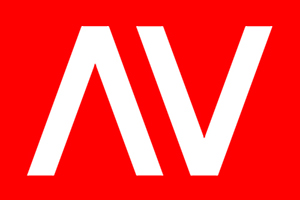

# AV-Raffle — Enterprise Event & Raffle System



**AV-Raffle** is the official corporate raffle, attendance verification, and prize distribution platform for **Avega Bros Integrated Logistics, Inc.** Built specifically for high-stakes corporate year-end celebrations and general assemblies across multiple locations (Tayud, Cebu & Makati City).

---

## 🎯 Architecture Overview

```
                                  +------------------------------------+
                                  |      4K Projector Canvas Stage     |
                                  |         (https://.../stage)        |
                                  +-----------------+------------------+
                                                    | WebSockets
+---------------------------+     WebSocket Sync    v
|   Emcee Remote Android    | <-----------------> [ Next.js 15 App Server ]
|   (SPIN / AWAIT CLAIM)    |                     | (Portainer Docker)   |
+---------------------------+                     +----------+-----------+
                                                             |
+---------------------------+     REST API / WebP            | Prisma ORM
| Registration Desk Android | -----------------------------> | SQLite DB
| (Mugshot + QR Check-In)   |                                |
+---------------------------+                                v
                                                  +----------------------+
+---------------------------+                     |  Persistent Storage  |
|  Prizes Management Mode   | ------------------> |  - /app/data/*.db    |
|  (Catalog, Scope & Edit)  |                     |  - /public/uploads/  |
+---------------------------+                     +----------------------+
```

### Key Components:
1. **Web Platform (`web/`):** Next.js 15 App Router, React 19, Tailwind CSS v4, Prisma ORM (SQLite), Socket.IO WebSockets, Sharp (WebP image processing), and GSAP / Canvas-Confetti animations.
2. **Mobile Companion (`mobile/`):** Flutter 3 Android app with camera capture, QR ticket scanner, tactile haptic vibrations, offline-first fallback, and role-based staff login.
3. **Multi-Location Scope:** Separate or unified raffle pools and prizes for **Tayud Land-Based**, **Makati Land-Based**, or **All Locations**.
4. **Attendance Mugshots:** Attendee portraits taken at registration automatically become their glowing winner announcement graphic on the 4K wheel stage.

---

## 🚀 Quick Start (Development)

### Prerequisites
- Node.js `v20+` or `v24+`
- Flutter SDK `^3.12.0` (with Android Studio / SDK platform tools)
- SQLite3

### 1. Web Application Setup
```bash
# Navigate to web directory
cd web

# Install dependencies
npm install

# Initialize database schema
npx prisma db push

# (Optional) Seed 2025/2026 employee roster & prizes
npx tsx scripts/seed-master-employees.ts

# Start the dev server on port 3000
npm run dev
```
Open [http://localhost:3000](http://localhost:3000) in your browser.

### 2. Mobile App Setup (Android)
```bash
# Navigate to mobile directory
cd mobile

# Get Flutter dependencies
flutter pub get

# Connect Android phone via USB and enable USB Debugging
# Forward port 3000 so the device reaches your local dev server
adb reverse tcp:3000 tcp:3000

# Run in debug mode on connected device
flutter run
```

---

## 🐳 Production Deployment (Portainer / Docker)

The repository includes a production-ready, multi-stage [`Dockerfile`](./Dockerfile) and [`docker-compose.yml`](./docker-compose.yml) configured with automatic SQLite migrations and persistent volumes.

### Deploying via Portainer Stack (Recommended)
1. In Portainer, go to **Stacks** > **+ Add stack**.
2. Name: `avraffle`
3. Build method: **Repository**
   - **Repository URL:** `https://github.com/avegabros/avraffle.git`
   - **Repository reference:** `refs/heads/main`
   - **Compose path:** `docker-compose.yml`
4. Click **Deploy the stack**.

### Standalone Docker Compose:
```bash
docker compose up -d --build
```

### Docker Compose Reference:
```yaml
version: '3.8'

services:
  raffle-web:
    build:
      context: .
      dockerfile: Dockerfile
    image: avegabros/avraffle:latest
    container_name: avraffle-web
    restart: unless-stopped
    ports:
      - "3300:3000"
    environment:
      - NODE_ENV=production
      - PORT=3000
      - DATABASE_URL=file:/app/data/raffle.db
      - NEXTAUTH_SECRET=your_production_secret_key_here
    volumes:
      - raffle-data:/app/data
      - raffle-uploads:/app/public/uploads

volumes:
  raffle-data:
    driver: local
  raffle-uploads:
    driver: local
```

### Nginx / Reverse Proxy Configuration
Point your domain `https://avraffle.abas.ph` to Port `3300` with **WebSockets Enabled**:
```nginx
server {
    server_name avraffle.abas.ph;

    location / {
        proxy_pass http://localhost:3300;
        proxy_http_version 1.1;
        proxy_set_header Upgrade $http_upgrade;
        proxy_set_header Connection "upgrade";
        proxy_set_header Host $host;
        proxy_set_header X-Real-IP $remote_addr;
        proxy_set_header X-Forwarded-For $proxy_add_x_forwarded_for;
        proxy_set_header X-Forwarded-Proto $scheme;
    }

    client_max_body_size 25M; # Allows high-res prize & mugshot uploads
}
```

---

## 📱 Mobile App Compilation (.APK & .AAB)

### 1. Generating `.apk` for Direct Distribution
To produce the optimized release APK (available for download directly on the landing page):
```bash
cd mobile
flutter build apk --release
```
- Output: `mobile/build/app/outputs/flutter-apk/app-release.apk` (~66.5 MB)
- Copy to web downloads:
  ```bash
  cp mobile/build/app/outputs/flutter-apk/app-release.apk web/public/downloads/avraffle-latest.apk
  ```

### 2. Generating `.aab` for Google Play Console
Google Play Console requires an Android App Bundle (`.aab`):
```bash
cd mobile
flutter build appbundle --release
```
- Output: `mobile/build/app/outputs/bundle/release/app-release.aab` (~59.4 MB)
- Upload this file under **Google Play Console > Production > Create new release**.

---

## 🔄 Unified Version Tracking

All version numbers across the Android app, Flutter build number, Next.js web app, and landing page download badges are managed from a **single file**:

### [`version.json`](./version.json)
```json
{
  "version": "1.0.0",
  "buildNumber": 1,
  "releaseDate": "2026-11-05",
  "name": "AV-Raffle",
  "package": "ph.abas.avraffle"
}
```

### To Bump Version:
1. Update `version` (e.g., `"1.0.1"`) and increment `buildNumber` in `version.json`.
2. Run the sync script:
   ```bash
   node scripts/sync-version.js
   ```
3. Commit and push:
   ```bash
   git commit -am "chore: bump version to v1.0.1"
   git push origin main
   ```

---

## 🎮 Mobile App Modes & Access Controls

| Mode | Access | Description |
|---|---|---|
| **Attendee Status Check** | Public (No Login) | Attendees check their raffle entry, wheel status, and claimed prizes by entering their Employee ID and Last Name (case-insensitive). |
| **Registration Desk** | Staff Sign-In | Scans employee QR codes or searches roster, captures camera mugshots, and activates them on the wheel. |
| **Emcee Spin Remote** | PIN Protected (`8888`) | Triggers the 4K stage wheel spin. Locks when a winner lands to prevent double spins until Emcee confirms `CONFIRM & CLAIM` or `ABSENT (RESPIN)`. |
| **Prizes Inventory** | Staff Sign-In | Tap-to-edit prizes, snap catalog photos, adjust quantities, set Grand Prize flags, and scope to Tayud or Makati. |

---

## 🌐 Web Routes & Portals

- **Landing Page (`/`):** Public showcase, download APK button, and Google Play metadata.
- **Privacy Policy (`/privacy`):** Compliant with Republic Act No. 10173 (Data Privacy Act of 2012) and Google Play Console requirements.
- **Terms of Service (`/terms`):** Corporate raffle guidelines and pseudorandom fair-play rules.
- **Attendee Check Portal (`/check`):** Case-insensitive web verification for employee status.
- **4K Projector Wheel Stage (`/stage`):** High-frame-rate canvas wheel with real-time winner modals and sound effects.
- **Winners & Prizes Slideshow (`/slideshow`):** Fullscreen projector carousel toggling between Prize Showcase and Winners History by Year/Location.
- **Admin Control Panel (`/admin`):**
  - `/admin/guests`: Attendee management, inline editing, and winner status resets.
  - `/admin/prizes`: Prize catalog management, quantities, and scope filters.
  - `/admin/users`: Admin account creation and role assignments.
  - `/admin/archive`: ABAS import and historical year-end winner archives.

---

## 🛠️ Routine Maintenance & Backup

### 1. Database & Uploads Backup
To back up the persistent database and photos from your Docker container:
```bash
# Backup SQLite Database
docker cp avraffle-web:/app/data/raffle.db ./backup_raffle_$(date +%F).db

# Backup Attendee & Prize Photos
docker cp avraffle-web:/app/public/uploads ./backup_uploads_$(date +%F)
```

### 2. Resetting the Wheel for a New Event Year
1. In `/admin`, change the Active Year to the new target year (e.g. `2027`).
2. Upload the new employee roster via the Excel/ABAS importer in `/admin/archive`.
3. Add the prizes designated for the new event year.
4. Old winners remain preserved in `/history` and `/slideshow` under their respective year tags.

---

## 📄 License & Ownership
Copyright © 2026 **Avega Bros Integrated Logistics, Inc.** All rights reserved.  
Internal corporate enterprise software. Unauthorized distribution or reproduction is strictly prohibited.
