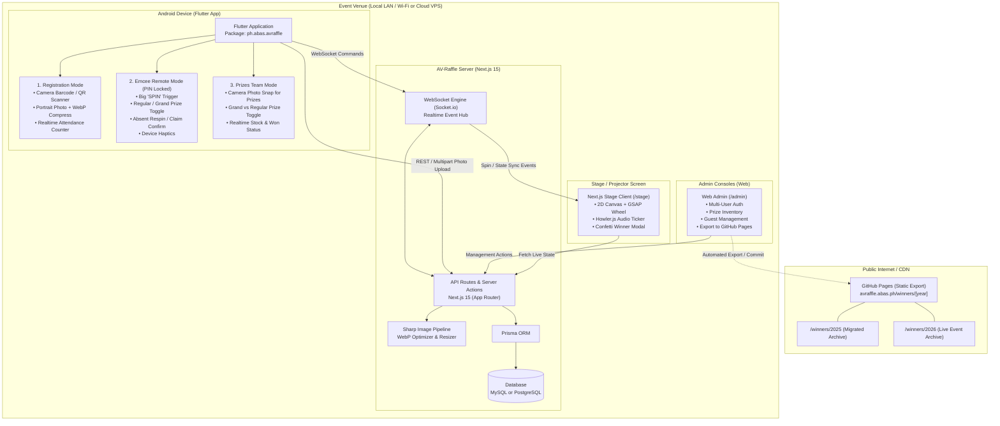
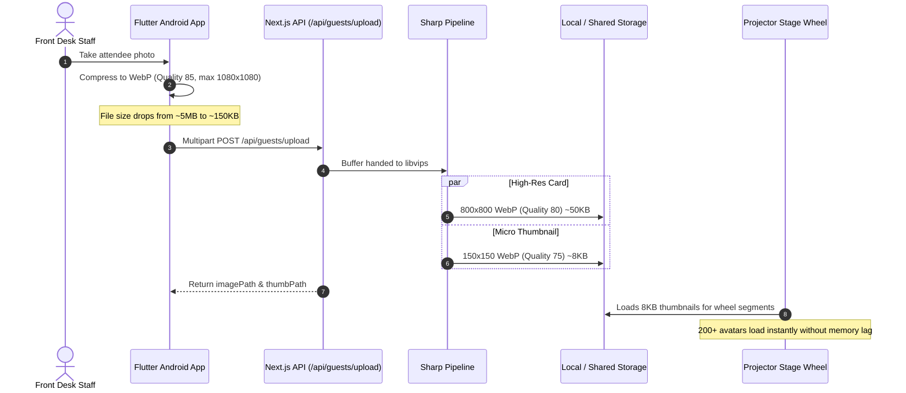

# AV-Raffle System Architecture & Technical Specification

## 1. Executive Summary
**AV-Raffle** is a complete, modernized port and enhancement of the legacy PHP/MySQL/Winwheel raffle system (`WHEEL-RAFFLE`). The solution delivers:
- A real-time **Next.js 15** web application providing the projector-facing interactive stage wheel, admin dashboards, and WebSocket hub.
- A **Flutter Android Mobile Application** with dual operational modes:
  1. **Registration Scanner Mode:** Quick attendee check-in, search, and portrait photo capture with client-side image compression.
  2. **Emcee Remote Mode (PIN-locked):** One-tap remote spin triggering, prize selection, and absent-winner respin controls.
- **GitHub Pages Archive Deployment:** Static hosting for past and current winners at `avraffle.abas.ph/winners/[year]`, enabling permanent archiving from 2025 onwards.
- **Optimized Asset Pipeline:** Automatic WebP dual-tier compression (standard card + micro-thumbnail) using `sharp` to reduce storage by 95%+.
- **Multi-User Admin System:** Role-based access control with hashed passwords for managing admins and registration staff.
- **Self-Service Attendee Verification Portal (`/check`):** Mobile-friendly public portal allowing attendees to scan a QR code with their own smartphones to verify their registration, raffle wheel eligibility, and ticket status without exposing personal details.

---

## 2. High-Level Architecture Diagram



---

## 3. Technology Stack Breakdown

| Layer | Technology | Version | Purpose |
| :--- | :--- | :--- | :--- |
| **Frontend Web** | Next.js (App Router), React, Tailwind CSS, shadcn/ui | 15.x / 19.x | Modern UI for stage projector, admin dashboard, check-in kiosk. |
| **Wheel Engine** | HTML5 Canvas 2D + GSAP (`gsap`) | 3.x | Deterministic 60fps wheel physics, deceleration curve, tick detection. |
| **Audio SFX** | Howler.js | 2.x | High-reliability Web Audio playback (ticks, fanfare, background audio). |
| **Effects** | `canvas-confetti` | 1.9+ | GPU-accelerated celebratory particle effects. |
| **Realtime Sync**| Socket.io (client & server) | 4.x | Sub-15ms bi-directional communication between Emcee remote & stage. |
| **Backend API** | Next.js Route Handlers / Server Actions | 15.x | REST endpoints for Flutter app, file uploads, and admin controls. |
| **Database & ORM**| Prisma ORM with MySQL / PostgreSQL | 5.x / 6.x | Type-safe migrations, queries, and multi-user data storage. |
| **Image Engine** | `sharp` (Node.js) + `flutter_image_compress` | Latest | Dual-stage WebP conversion and thumbnail generation. |
| **Mobile App** | Flutter (Dart) | 3.x | Cross-platform APK for rapid camera registration & Emcee remote. |
| **Static Archive**| Next.js Static Export (`output: 'export'`) | 15.x | Free, high-speed CDN hosting at `avraffle.abas.ph` via GitHub Pages. |

---

## 4. Database Schema Specification (Prisma)

```prisma
datasource db {
  provider = "mysql" // or postgresql
  url      = env("DATABASE_URL")
}

generator client {
  provider = "prisma-client-js"
}

enum Role {
  SUPERADMIN
  ADMIN
  REGISTRATION_STAFF
}

enum PrizeType {
  REGULAR
  GRAND
}

model User {
  id           String    @id @default(cuid())
  username     String    @unique
  passwordHash String
  name         String
  role         Role      @default(ADMIN)
  isActive     Boolean   @default(true)
  createdAt    DateTime  @default(now())
  updatedAt    DateTime  @updatedAt

  @@map("admin_users")
}

model Guest {
  id           Int       @id @default(autoincrement())
  employeeId   String    @unique @map("employee_id")
  firstName    String    @map("first_name")
  middleName   String?   @map("middle_name")
  lastName     String    @map("last_name")
  assigned     String?
  department   String?
  position     String?
  imagePath    String?   @map("image")
  thumbPath    String?   @map("thumb_image")
  registeredOn DateTime  @default(now()) @map("registered_on")
  
  // Raffle Eligibility Flags
  isRegistered Boolean   @default(false) @map("stat") // 1 = checked in
  inWheel      Boolean   @default(false) @map("wheel") // 1 = included in draw
  isWinner     Boolean   @default(false) @map("winner") // 1 = won a prize
  winOn        DateTime? @map("win_on")
  prizeWon     String?   @map("prize")
  
  // Relation to Won Grand Prize (if applicable)
  grandPrizeWon Prize?   @relation("GuestWonPrize")

  @@index([inWheel, isWinner])
  @@index([lastName, firstName])
  @@map("guest")
}

model Prize {
  id           Int       @id @default(autoincrement())
  name         String
  description  String?
  type         PrizeType @default(REGULAR)
  isGrandPrize Boolean   @default(false) @map("is_grand_prize")
  imagePath    String?   @map("image_path")
  quantity     Int       @default(1)
  isWon        Boolean   @default(false) @map("is_won")
  wonByGuestId Int?      @unique @map("won_by")
  wonOn        DateTime? @map("won_on")
  createdAt    DateTime  @default(now()) @map("created_at")

  wonBy        Guest?    @relation("GuestWonPrize", fields: [wonByGuestId], references: [id])

  @@map("prizes")
}

model SystemSetting {
  key         String   @id
  value       String   @db.Text
  updatedAt   DateTime @updatedAt

  @@map("system_settings")
}
```

---

## 5. Flutter Android Application Design

The Android application operates as a single unified binary with two distinct execution profiles switched via a manager PIN.

### 5.1 Profile 1: Registration Mode (Front Desk Staff)
- **High-speed QR/Barcode Scanner:** Utilizing `mobile_scanner` to detect badge numbers in $< 100$ms.
- **Manual Search & Check-in:** Real-time search query against the guest list.
- **In-App Camera Capture:**
  - Guides front desk staff with a facial portrait silhouette overlay.
  - Automatically crops to a 1:1 aspect ratio.
  - Compresses client-side using `flutter_image_compress` (target size: $\le 150$KB in WebP format).
- **Offline / Local Queue:** In case of temporary Wi-Fi hiccups, check-ins queue locally in SQLite and flush once the network restores.

### 5.2 Profile 2: Emcee Remote Mode (Stage Host)
- **PIN-Protected Gate:** Emcees cannot access administrative or attendee data.
- **Minimalist, High-Contrast UI:**
  - Giant green **"SPIN WHEEL"** button with tactile confirmation dialog.
  - Prize selector drawer: Toggle between **Regular Prize** and **Grand Prize** (with live images of remaining grand prizes).
  - Duration & Power Sliders (5s – 20s; Low/Med/High).
- **Live Sync Feedback:**
  - Device vibrates (`vibration` package) when the spin starts and when the wheel lands on a winner.
  - Live card preview showing the winner's photo, employee ID, and name.
  - **"Confirm Win"** or **"Absent / Respin"** buttons to handle no-show attendees directly from the stage.

---

## 6. Photo Compression & Asset Pipeline



---

## 7. Realtime WebSocket Protocol Specification

All remote control commands and stage state synchronization run across a unified Socket.io room (`room:raffle-stage`).

### Event Dictionary:
1. `remote:select-prize`
   - **Payload:** `{ prizeId: number | null, isGrand: boolean, prizeName: string }`
   - **Effect:** Stage immediately switches visual banner to "GRAND PRIZE DRAW: [Prize Name]" with grand prize artwork.
2. `remote:set-spin-config`
   - **Payload:** `{ duration: number, power: "low" | "medium" | "high" }`
   - **Effect:** Updates the stage's deceleration curve and spin duration.
3. `remote:trigger-spin`
   - **Payload:** `{ emceeId: string, timestamp: number }`
   - **Effect:** Server determines winner deterministically, calculates stop angle $\theta$, and emits `stage:start-spin` to all connected screens.
4. `stage:start-spin`
   - **Payload:** `{ targetWinner: Guest, targetAngle: number, duration: number }`
   - **Effect:** Wheel canvas initiates rotation animation with synced Howler ticking.
5. `stage:celebrate-winner`
   - **Payload:** `{ winner: Guest, prize: Prize }`
   - **Effect:** Modal opens, confetti blasts, fanfare audio plays, Emcee phone vibrates.
6. `remote:respin-absent`
   - **Payload:** `{ guestId: number, reason: string }`
   - **Effect:** Marks guest as absent/skipped, resets wheel, ready for immediate redraw.

---

## 8. GitHub Pages Static Archive Strategy

To provide permanent, cost-free public access to winners across past and current years at **`https://avraffle.abas.ph/winners/[year]`**:

### Directory Structure of Archive:
```
docs/winners-site/ (or separate git branch: gh-pages)
├── CNAME (avraffle.abas.ph)
├── index.html (Redirects to latest year)
└── winners/
    ├── 2025/
    │   ├── index.html
    │   ├── data.json (migrated from attendance.sql)
    │   └── photos/
    └── 2026/
        ├── index.html
        ├── data.json (compiled post-event)
        └── photos/
```

### Publication Workflow:
1. **Migration of 2025 Data:**
   - Execute a CLI node script `npm run migrate:2025` which reads legacy `attendance.sql`, extracts all rows with `winner = 1`, and creates `data/winners/2025.json`.
2. **One-Click Post-Event Export:**
   - Inside the Admin panel `/admin/export`, click **"Generate & Publish Archive"**.
   - Server runs a static render of `/winners/2026`, packages images and JSON, and pushes to GitHub repository using GitHub API or Git CLI action.
   - Cloudflare / GitHub Pages handles SSL and global caching under `avraffle.abas.ph`.

---

## 9. Security, Authentication & Role Management

1. **Authentication:**
   - Secure HTTP-only cookies storing encrypted session tokens (`iron-session` or standard JWT).
   - Passwords hashed using `bcrypt` (12 salt rounds).
2. **Role-Based Access Control (RBAC):**
   - **Superadmin:** Create/delete admin accounts, purge event data, full database controls.
   - **Admin:** Manage prizes, draw controls, export archives, view all attendees.
   - **Registration Staff:** Restricted strictly to `/check-in` and photo capture endpoints.
3. **Emcee PIN Gate:**
   - Emcee mobile interface protected by a rotating 4-digit session PIN to prevent accidental or malicious triggering by unauthorized devices on the venue network.
4. **Attendee Privacy Protection on Self-Check:**
   - Sensitive details (such as contact info or full database records) are never exposed.
   - Lookups require exact `employeeId` + `lastName` (or a secure signed QR token).
   - Rate-limited to prevent brute-force employee ID enumeration.

---

## 10. Self-Service Attendee Status Check Portal (`/check`)

Attendees can scan a posted event QR code or visit `avraffle.abas.ph/check` on their own mobile browsers to confirm their raffle entry.

### Verification Flow:
1. **Entry Point:** Attendee enters their **Employee ID** and **Last Name** (or scans their badge QR code).
2. **Instant Status Feedback:**
   - 🟢 **Confirmed & In Wheel:** *"You're all set! You are in the active raffle wheel."*
   - 🟡 **Registered but Not in Wheel:** (e.g. if already won a prize, or needs front-desk clearance).
   - 🔴 **Not Yet Checked In:** *"Please proceed to the registration desk to complete your check-in and photo."*
3. **Live Raffle Ticket Card:** Displays their registered portrait, department, registered timestamp, and raffle eligibility badge.

---

## 11. Repository Directory Structure

```
c:\code\av-raffle\
├── docs/
│   ├── ARCHITECTURE.md          <-- This document
│   └── API_SPEC.md              <-- Detailed endpoints and socket schemas
├── web/                         <-- Next.js 15 Application
│   ├── app/
│   │   ├── (auth)/login/
│   │   ├── check/               <-- Self-service attendee status check
│   │   ├── admin/
│   │   │   ├── guests/
│   │   │   ├── prizes/
│   │   │   ├── users/
│   │   │   └── export/
│   │   ├── stage/               <-- Projector Screen Wheel
│   │   ├── winners/[year]/      <-- Multi-year winners page
│   │   └── api/
│   │       ├── auth/
│   │       ├── check-status/    <-- Rate-limited public lookup API
│   │       ├── guests/
│   │       └── prizes/
│   ├── components/
│   │   ├── wheel/               <-- Canvas 2D + GSAP Wheel component
│   │   ├── stage/               <-- Winner modal, sound manager
│   │   └── ui/                  <-- shadcn/ui components
│   ├── lib/
│   │   ├── db.ts                <-- Prisma client
│   │   ├── sharp.ts             <-- Image pipeline
│   │   └── socket.ts            <-- Socket.io handler
│   ├── prisma/
│   │   └── schema.prisma
│   ├── public/
│   │   ├── audio/               <-- Migrated tick & winner sounds
│   │   └── uploads/             <-- WebP photo storage
│   ├── Dockerfile
│   └── docker-compose.yml
├── mobile/                      <-- Flutter Android Application
│   ├── lib/
│   │   ├── main.dart
│   │   ├── modes/
│   │   │   ├── registration/    <-- Scanner & photo capture UI
│   │   │   └── emcee/           <-- Remote spin controller UI
│   │   ├── services/
│   │   │   ├── api_service.dart
│   │   │   ├── socket_service.dart
│   │   │   └── image_compress.dart
│   │   └── widgets/
│   └── pubspec.yaml
└── scripts/
    └── migrate-2025-winners.ts  <-- Extraction script for legacy data
```
